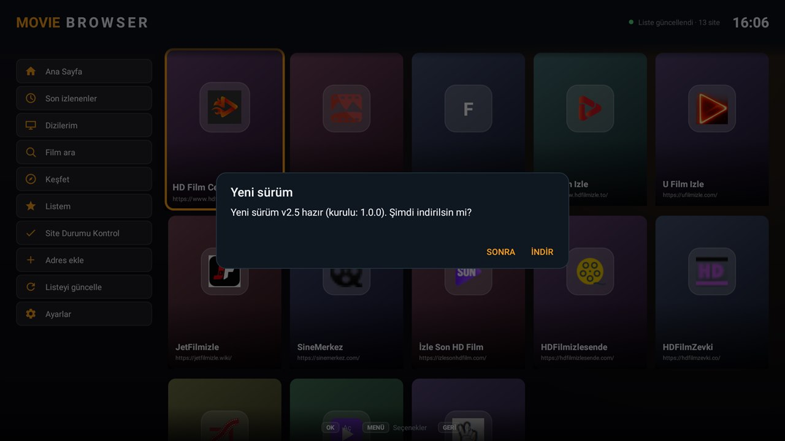
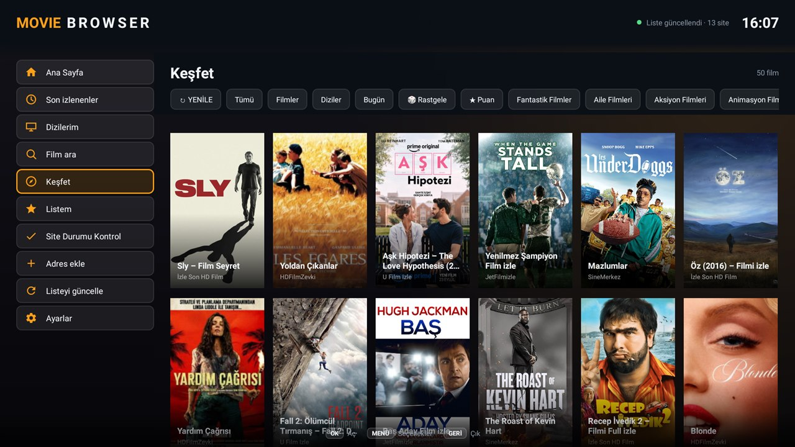
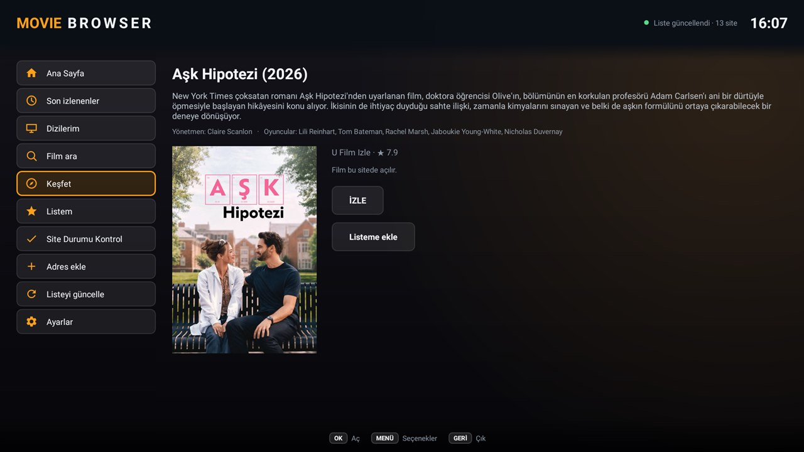
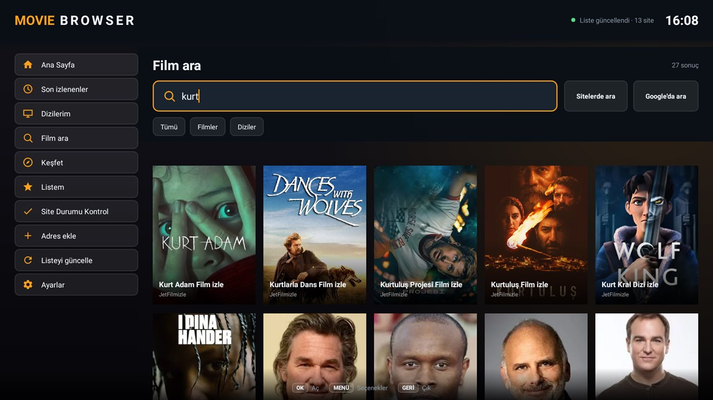
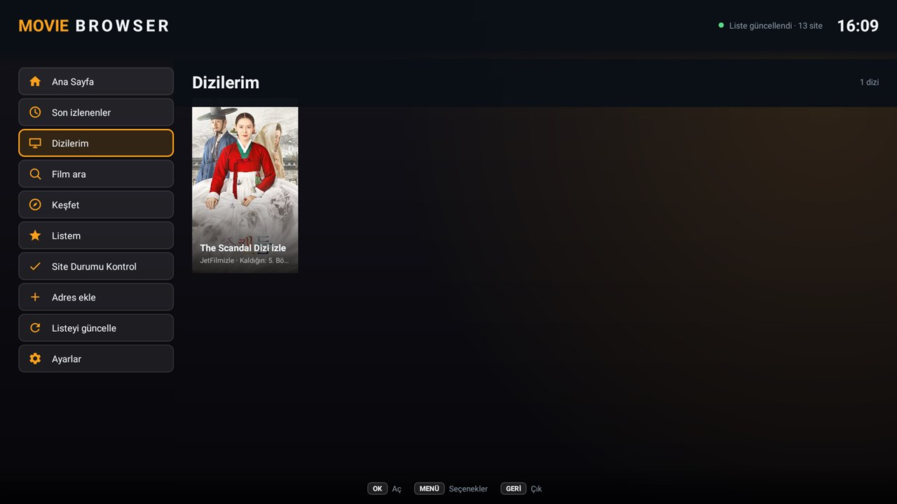
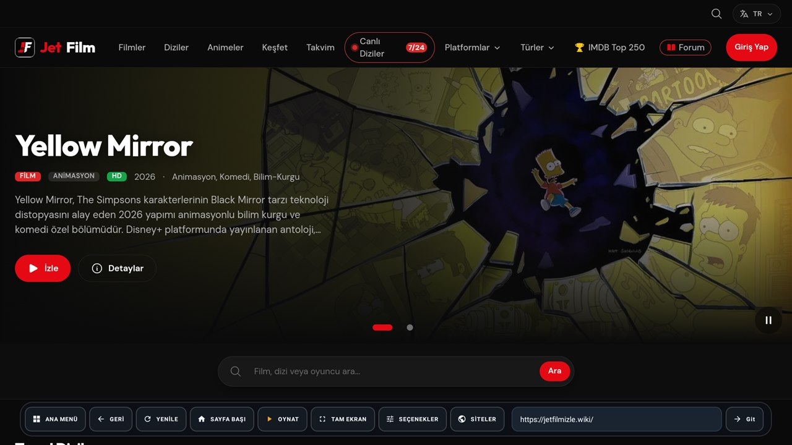
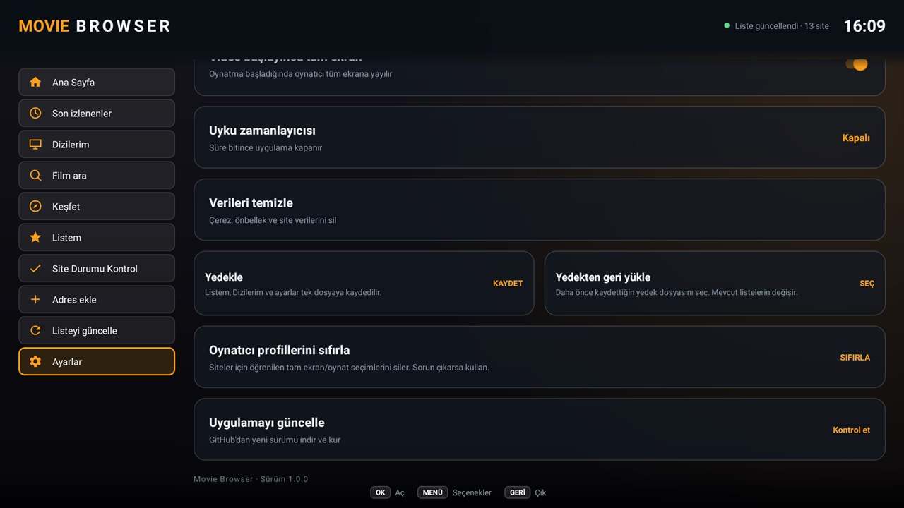

# Movie Browser — Android TV film tarayıcısı

Android TV (ve telefon/emülatör) için **WebView tabanlı film tarayıcısı**. Site listesini bu repodaki
[`sites.json`](sites.json) dosyasından çeker; listedeki değişiklik uygulamanın bir sonraki açılışında
(veya **Listeyi güncelle** kartına basınca) geçerli olur. Kumanda, mouse ve dokunmatik ile çalışır.

**Sürüm:** `1.0.0`



## Ekran görüntüleri

| Keşfet | Film detayı |
|---|---|
|  |  |
| **Film ara** | **Dizilerim** |
|  |  |
| **Tarayıcı / oynatıcı** | **Ayarlar** |
|  |  |

## Özellikler

### Ana ekran ve gezinme
- **Sabit sol menü**: Ana Sayfa, Son izlenenler, Dizilerim, Film ara, Keşfet, Listem, Site Durumu Kontrol, Adres ekle, Listeyi güncelle, Ayarlar.
- Site ızgarası; **favori siteler**, uzun basıp **yukarı/aşağı taşıma**.
- **Adres ekle**: girilen adres listeye kalıcı eklenir (canlı site önizlemesi + "listede var" uyarısı), kullanıcı sitesi uzun basıp çıkarılabilir.
- **Renkli kumanda tuşları**: 🔴 Keşfet · 🟢 Listem · 🟡 Dizilerim · 🔵 Film ara (yazı alanlarında devre dışı).

### Keşfet
- Tüm siteler taranır; aynı film farklı sitelerde tekilleştirilir, siteler arası dönüşümlü listelenir.
- Filtreler: **Tümü / Filmler / Diziler / Bugün**, site çipleri ve sitelerin kategori menülerinden gelen **tür çipleri** (Aksiyon, Dram, Komedi…).
- Kartlarda TMDB **yıl ve ★ puan**; **★ Puan** ile sıralama, **🎲 Rastgele** ile tek tuş film açma.
- 5 dakikalık önbellek + **↻ YENİLE**; önbellek boşken arama için arka planda liste toplama.

### Film ara
- **Uygulama içi arama**: Keşfet akışı, Listem, Dizilerim ve son izlenenlerde anında arar (ağ yok).
- **Sitelerde ara**: tüm sitelerin **kendi arama sayfalarında** canlı arama. Site formu keşfedilir, çalışan adres kalıbı site başına hatırlanır; ilerleme "Sitelerde aranıyor: 9/13" olarak gösterilir.
- **Türkçe tolerans**: "ask" yazınca "Aşk…" bulunur.
- Sonuç yoksa **Google'da ara**.

### Film / dizi detayı
- Bilgiler yalnız **TMDB**'den: Türkçe başlık, yıl, ★ puan, özet, yönetmen ve oyuncular (Wikipedia kullanılmaz).
- **İZLE**: film sayfası açılır, oynatıcı kendiliğinden başlar ve tam ekrana geçer.
- **Listeme ekle / Listemden çıkar**; dizi ise **Dizilerim**'e de eklenir.
- **Diğer kaynaklar**: aynı film başka sitelerde varsa **en hızlı site önce** (ms etiketli, arka planda hız ölçümü).
- Dizilerde **Bölümler** listesi (kaldığın bölüm işaretli) ve **Sıradaki bölüm**.

### Listem · Son izlenenler · Dizilerim
- Poster ızgarası, başlıkta **arama**, **OK'a basılı tut** → listeden çıkar.
- **Son izlenenler**: en son izlenen kartında **▶ DEVAM** ve kalınan bölüm.
- **Dizilerim**: takip edilen diziler, "Kaldığın: …" etiketi; yeni bölüm varsa **YENİ** rozeti (uygulama açılışında arka planda kontrol). Takibi bırakmak listeden de çıkarır.

### Tarayıcı
- **Player tarzı araç çubuğu**: ANA MENÜ · GERİ · YENİLE · SAYFA BAŞI · OYNAT · TAM EKRAN · SEÇENEKLER · SİTELER · kısa adres çubuğu · Git.
- **Reklam engelleme**: istek seviyesinde reklam/pop ağları + sayfa içi reklam kutuları.
- **Tam ekran**: oynatıcı kabı / iframe / video otomatik analiz edilir; önce oynatıcının **kendi tam ekranı** denenir, olmazsa oynatıcı kaplanır; sayfa başlığı, menü, "Yardım/İndir" gibi bantlar gizlenir (çıkışta geri gelir).
- **Oynatıcı profili**: hangi tam ekran/oynat öğesinin çalıştığı **site başına öğrenilir**; Ayarlar'dan sıfırlanabilir.
- **HLS kalite**: master listedeki **1080p altı varyantlar atılır**, oynatıcı en az 1080p seçer. Sağ üstte **kalite rozeti** (1080p gri, altı turuncu).
- **Otomatik oynatma** ve bölüm bitince **otomatik sonraki bölüm**.
- **SEÇENEKLER**: sayfadaki kalite/sunucu/dil seçenekleri tek listede; **harici oynatıcı** (VLC) desteği.
- **Site bazlı VPN**: bir sitede VPN açtıysan hatırlanır, sonraki açılışta otomatik bağlanır.
- Yeni pencere desteği (oynatıcı yeni sekme açarsa aynı ekranda), medya tuşları (oynat/duraklat/ileri/geri).

### Site Durumu Kontrol
- Tüm siteler için erişilebilirlik + yanıt süresi (ms) testi; durum noktaları ve sıralama; **TEST ET** ile yenileme.

### Ayarlar
- VPN (Cloudflare WARP), masaüstü görünüm, video başlayınca tam ekran, uyku zamanlayıcısı.
- Verileri temizle (çerez/önbellek), **Yedekle / Yedekten geri yükle** (JSON; Listem, Dizilerim, geçmiş, favoriler, siteler, VPN hafızası, aramalar, ayarlar), **Oynatıcı profillerini sıfırla**.
- **Uygulamayı güncelle**: GitHub sürümlerinden APK indirip kurulum ekranını açar.
- Sürüm değişince **Yenilikler** penceresi.

## Kurulum

- **APK**: [sürümler](https://github.com/thenorth/moviebrowser/releases) sayfasından indirip TV'ye kurun (Android 5.1 / API 21+).
- USB ile: APK'yı TV'ye kopyalayıp dosya yöneticisinden kurun.
- ADB ile:

```bash
adb connect <TV-IP>:5555
adb install -r moviebrowser.apk
```

## Site listesini güncelleme

Kaynak sırası (bazı ISS'ler `raw.githubusercontent.com`'u engeller):
1. `raw.githubusercontent.com`
2. `cdn.jsdelivr.net/gh/thenorth/moviebrowser@main/sites.json`
3. `raw.githack.com/thenorth/moviebrowser/main/sites.json`

Üçü de başarısızsa son bilinen liste kullanılır; üst sağda kırmızı nokta + "Liste güncellenemedi" görünür.

### Otomatik keşif

`tools/discover.js` Türkçe arama kalıplarıyla yeni siteleri bulur, doğrular ve `sites.json`'a ekler:

```bash
node tools/discover.js --dry   # sadece rapor
node tools/discover.js         # listeye ekle
```

`.github/workflows/update-sites.yml` bu betiği **her gün 06:00 UTC** çalıştırıp değişikliği commit eder.
Elenenler: film izletmeyen rehber/veritabanı siteleri, ücretli platformlar, arama motorları, forumlar,
erişilemeyen alan adları.

## Yapı

| Dosya | İş |
|---|---|
| `MainActivity.kt` | Site ızgarası, sol menü, paneller, güncelleme, yedekleme |
| `BrowserActivity.kt` | WebView, araç çubuğu, tam ekran, VPN, kalite rozeti |
| `Panels.kt` | Keşfet, Listem, Son izlenenler, Dizilerim, arama, detay, durum, ayarlar |
| `Scraper.kt` / `SiteSearch.kt` | Site kazıma, bölümler, sitelerde arama |
| `Tmdb.kt` | TMDB film/dizi bilgisi, oyuncular, benzerler |
| `Fullscreen.kt` / `Player.kt` / `PlayerProfile.kt` | Oynatıcı analizi, tam ekran, site profili |
| `Quality.kt` | HLS master listesi → minimum 1080p |
| `AdBlock.kt` / `Nav.kt` / `PlayerOptions.kt` | Reklam engelleme, kumanda gezinmesi, oynatıcı seçenekleri |
| `History.kt` / `Watchlist.kt` / `Favorites.kt` / `UserSites.kt` | Kalıcı listeler |
| `Backup.kt` | JSON yedekle / geri yükle |
| `SiteRepository.kt` + `sites.json` | Uzak site listesi |

> Not: Proje yolu Türkçe karakter içeriyorsa Windows'ta AGP uyarı verir; `gradle.properties`
> içindeki `android.overridePathCheck=true` bunu susturur.


